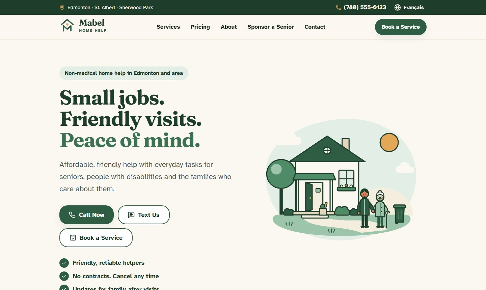
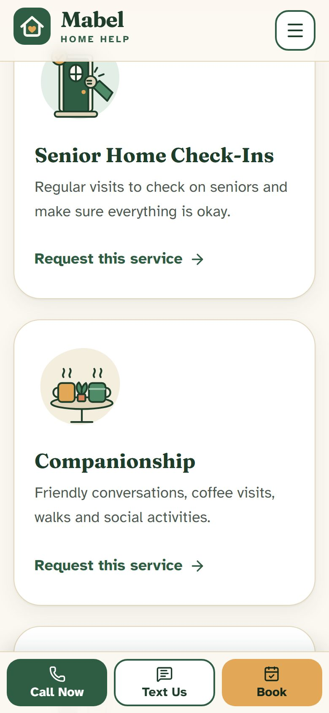
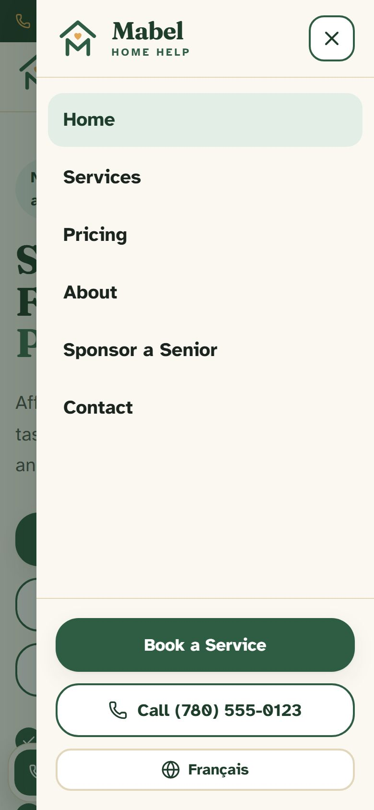
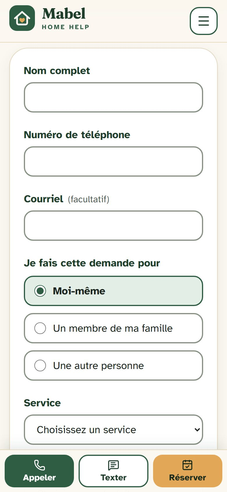
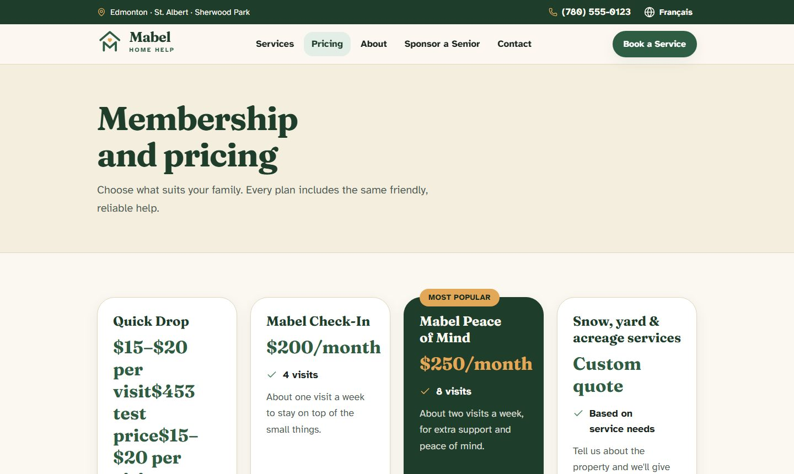
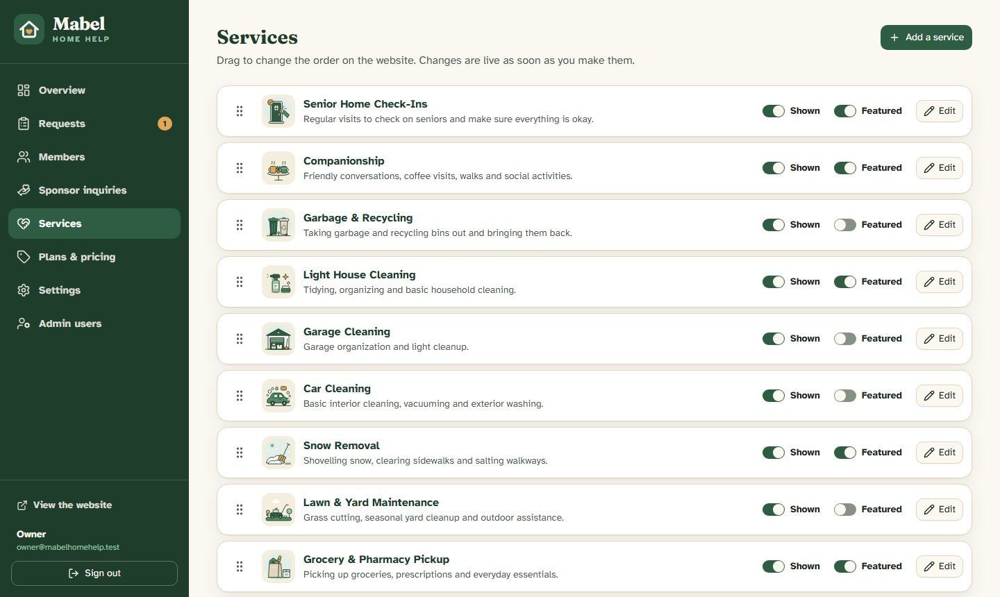
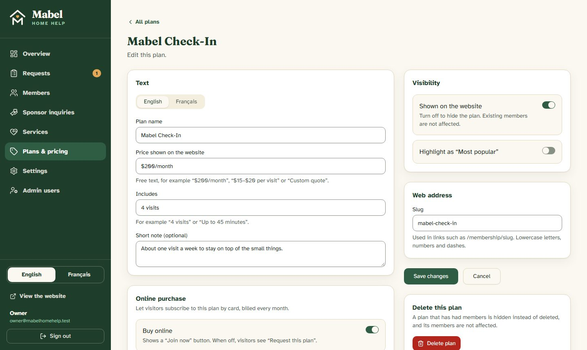

<p align="center">
  
</p>

<p align="center">
  <strong>Small jobs. Friendly visits. Peace of mind.</strong><br>
  Website and admin dashboard for a non-medical home-help service for seniors in Edmonton, Alberta.
</p>

<p align="center">
  <a href="https://github.com/MTSALAA/MABEL_HOME_HELP/actions/workflows/ci.yml"></a>
  
  
  
  
  
  
</p>

<p align="center">
  
</p>

## Contents

- [What it does](#what-it-does)
- [Screens](#screens)
- [Built with](#built-with)
- [Run it locally](#run-it-locally)
- [Commands](#commands)
- [How it is put together](#how-it-is-put-together)
- [Going live](#going-live)
- [How it looks after itself](#how-it-looks-after-itself)
- [Troubleshooting](#troubleshooting)
- [Documentation](#documentation)
- [License](#license)

## What it does

**For visitors**

- A fast, static marketing site in English and French: services, pricing,
  about, contact and a Sponsor a Senior page.
- Large text, big buttons and simple navigation for seniors and their
  families, with Call, Text and Book always one tap away on a phone.
- Request forms for a service, a general message or a sponsorship, with spam
  protection and confirmation emails in the visitor's language.
- Monthly memberships bought online by card through Stripe, with a
  self-service link to update the card or cancel.

**For the owner**

- A dashboard to edit services, plans, prices and contact details in both
  languages. Changes appear on the site as soon as they are saved.
- Inboxes for requests and sponsor inquiries, with statuses, private notes,
  search and CSV export.
- A members list mirrored from Stripe, with billing status and cancellation.
- Warnings when something that should be configured is not.

**Built to be trusted**

- Every screen is tested at six widths in both languages, and checked
  automatically against WCAG 2.1 / 2.2 A and AA.
- Payments are confirmed from live Stripe state, survive missed or out-of-order
  webhooks, and never rely on anything sent by the browser.
- Lighthouse (mobile): performance 91 to 93, accessibility, best practices and
  SEO 100.

## Screens

<table>
  <tr>
    <td width="25%"></td>
    <td width="25%"></td>
    <td width="25%"></td>
    <td width="25%"></td>
  </tr>
  <tr>
    <td align="center">Home</td>
    <td align="center">Services</td>
    <td align="center">Menu</td>
    <td align="center">Booking, in French</td>
  </tr>
</table>

<table>
  <tr>
    <td width="50%"></td>
    <td width="50%"></td>
  </tr>
  <tr>
    <td align="center">Membership and pricing</td>
    <td align="center">Admin: services, drag to reorder</td>
  </tr>
  <tr>
    <td width="50%"></td>
    <td width="50%" valign="top">
      <br>
      The admin works on a phone and can be used in English or French
      (a switch in the menu, remembered per browser). Every field that
      appears on the public site has an English and a French version; a French
      field left empty falls back to English.
    </td>
  </tr>
  <tr>
    <td align="center">Admin: plan editor</td>
    <td></td>
  </tr>
</table>

The illustrations and logo are original SVGs in `public/illustrations/` and
`public/brand/`. The other logo directions that were drawn, on one sheet, are
in [`docs/brand/`](docs/brand/logo-options.png). Phone numbers and emails in
the screenshots are placeholders.

## Built with

| Layer | Choice |
|---|---|
| Framework | Next.js 16 (App Router, Cache Components), React 19, TypeScript strict |
| Styling and UI | Tailwind CSS 4, shadcn/ui on Radix for the admin, Lucide icons |
| Data | PostgreSQL (Neon in production), Prisma |
| Auth | Better Auth, email and password, admins only |
| Languages | next-intl, English and Canadian French |
| Payments | Stripe Billing: Checkout, Customer Portal, webhooks |
| Email | Resend, React templates |
| Forms | React Hook Form and Zod, shared between browser and server |
| Protection | Cloudflare Turnstile, Upstash rate limiting, strict security headers |
| Tests | Vitest, Playwright, axe-core |
| Hosting | Vercel |

## Run it locally

Requirements: Node.js 20.9 or newer (22 LTS recommended) and npm. No Docker
needed: the dev database is an embedded Postgres.

```bash
npm install
cp .env.example .env        # then fill in BETTER_AUTH_SECRET and the SEED_ADMIN_* values
npm run db:start            # terminal 1: local Postgres on port 5433 (keep it running)
npm run db:deploy           # terminal 2: create the tables
npm run db:seed             # 13 services, 4 plans, settings, first admin user
npm run dev                 # http://localhost:3000
```

- Public site: <http://localhost:3000> (French under `/fr`)
- Admin: <http://localhost:3000/admin>, signed in with the `SEED_ADMIN_EMAIL` /
  `SEED_ADMIN_PASSWORD` from your `.env`

Without the optional keys the app still works: emails are printed to the dev
server console, spam checks fall back to the honeypot and an in-memory rate
limit, and plans show "Request this plan" instead of "Join now".

## Commands

| Command | What it does |
|---|---|
| `npm run dev` | Development server |
| `npm run build` / `npm start` | Production build and server |
| `npm run typecheck` | Generate route types, then `tsc` |
| `npm run lint` | ESLint |
| `npm test` | Unit tests (Vitest), including the EN/FR translation parity check |
| `npm run test:e2e` | End-to-end tests (Playwright) against a production build on port 3100: user flows, every screen at six widths (no sideways scroll or cut-off text, in both languages), and automated WCAG A/AA checks |
| `npm run db:start` | Local Postgres (data in `.pgdata/`) |
| `npm run db:migrate` | Create and apply a migration after editing `prisma/schema.prisma` |
| `npm run db:deploy` | Apply existing migrations (used in production and CI) |
| `npm run db:seed` | Starter content into an empty database, and the first admin while there are no users |
| `npm run db:studio` | Browse the database |

First end-to-end run on a machine: `npx playwright install chromium`.

## How it is put together

| Area | Where | Notes |
|---|---|---|
| Public pages | `src/app/[locale]/` | Statically prerendered. Text comes from `messages/en.json` and `messages/fr.json` |
| Admin | `src/app/admin/` | English and French (a cookie, not a URL), its own root layout. Text is under `Admin` in the message files. Every page and action calls `requireAdmin()` |
| Editable content | `src/server/queries/content.ts` | Cached with `use cache` and one tag; admin saves call `updateTag` so the site updates at once |
| Forms | `src/components/forms/`, `src/server/actions/public.ts` | Zod schemas in `src/lib/validation/` are shared by browser and server |
| Admin actions | `src/server/actions/admin/` | Server Actions; the only API routes are auth and the Stripe webhook |
| Memberships | `src/server/stripe.ts`, `src/server/stripe-webhook.ts` | Stripe is the source of truth; the `Membership` table mirrors it via webhooks |
| Email | `src/server/email/` | Resend; templates are React, visitor emails follow the visitor's language |
| Illustrations | `public/illustrations/`, `public/brand/` | One SVG per file; replace a file to change the art |

This project uses Next.js 16 with Cache Components. A few conventions follow
from that and are easy to trip over:

- Anything that reads the request (session, `searchParams`, unknown `params`)
  must sit inside a `<Suspense>` boundary.
- Do not call `new Date()` or `Math.random()` while rendering a public page.
- Request interception lives in `src/proxy.ts` (the file formerly called
  middleware).
- Locale comes from the `[locale]` root segment (`next/root-params`); Server
  Actions and Route Handlers must be given the locale explicitly.

## Going live

1. **Hosting and database**: deploy to Vercel and add a Neon Postgres database
   from the project's Storage tab. That creates `DATABASE_URL` (pooled) and
   `DATABASE_URL_UNPOOLED` (direct) by itself; with any other host, set those
   two by hand. Vercel runs the `vercel-build` script before every build: it
   applies database migrations, then runs the seed. The seed only fills an
   empty database (starter content) and only creates the first admin while
   there are no users, so later deploys never undo what was changed in the
   admin.
2. **Auth**: set a fresh `BETTER_AUTH_SECRET`, and `BETTER_AUTH_URL` /
   `NEXT_PUBLIC_SITE_URL` to the real domain. Set `SEED_ADMIN_EMAIL` and
   `SEED_ADMIN_PASSWORD` (10 characters or more) before the first deploy: that
   becomes the owner's sign-in. The password can be changed afterwards through
   "Forgot your password?" once email is set up.
3. **Email**: verify the sending domain in Resend (SPF, DKIM, DMARC), set
   `RESEND_API_KEY` and `EMAIL_FROM`.
4. **Spam protection**: create a Cloudflare Turnstile widget, set both keys.
   Create an Upstash Redis database and set both `UPSTASH_*` values (the
   in-memory fallback is not shared between serverless instances).
5. **Stripe**: the business owner creates and verifies the Stripe account.
   - Set `STRIPE_SECRET_KEY` (test key on preview, live key on production only).
   - Add a webhook endpoint at `https://<domain>/api/stripe/webhook` for
     `checkout.session.completed`, `invoice.paid`, `invoice.payment_failed`,
     `customer.subscription.updated`, `customer.subscription.deleted`, and set
     `STRIPE_WEBHOOK_SECRET`. "Join now" only appears once both keys are set,
     so nobody can pay before payments can be recorded.
   - Never point a preview deployment with test keys at the production
     database: Stripe ids from one mode do not exist in the other.
   - Enable the Customer Portal in Stripe (allow card updates and cancellation
     at period end).
   - In the admin, open each "Buy online" plan and save it once: that creates
     its Stripe product and price.
   - If the business is GST-registered, configure Stripe Tax and set
     `STRIPE_AUTOMATIC_TAX=true`, then update the price note on the pricing page.
6. **Content**: in the admin, set the confirmed phone number and email, review
   plan prices, and have a French speaker review the French site.
7. **Monitoring**: set `SENTRY_DSN` to turn on error reporting.

After launch, the admin overview shows a warning for any of these that is
still missing (email, spam protection, rate limiting, Stripe).

## How it looks after itself

There is no scheduler. Opening the admin overview triggers routine clean-up
(`src/server/housekeeping.ts`):

- requests and sponsor inquiries older than 24 months are deleted, as the
  privacy policy states;
- sign-ups still marked unpaid are checked against Stripe: a payment whose
  webhook was missed is activated, an expired checkout is removed;
- expired admin sessions and old webhook receipts are removed.

If a payment ever arrives that matches no sign-up record, the owner gets an
"Action needed" email with the Stripe references.

Testing payments locally: use Stripe test keys and forward webhooks with
`stripe listen --forward-to localhost:3000/api/stripe/webhook`.

## Troubleshooting

- **The page keeps reloading in development**: a production build ran into the
  dev server's folder. Stop the dev server, delete `.next/`, start it again.
  `npm run test:e2e` is safe to run alongside `npm run dev` because it builds
  into `.next-e2e/`.
- **`npm install` fails with "Cannot read properties of null (reading
  'edgesOut')"**: an npm 10.7 bug. Run `npx npm@10.9.4 install` instead, or
  upgrade npm.
- **The build fails with a database error**: public pages are prerendered from
  the database, so `DATABASE_URL` must be reachable at build time.
- **`npm run test:e2e` fails with "ENOTEMPTY ... .next-e2e"**: a previous test
  server was interrupted. Delete `.next-e2e/` and run it again.
- **Hosting somewhere other than Vercel**: rate limits are keyed on the
  visitor's address from the `x-forwarded-for` header, so the site must sit
  behind a proxy that sets that header itself rather than passing on whatever
  the visitor sends.
- **`ajv` and `ajv-formats` in `devDependencies`**: nothing imports them. They
  are pinned only so npm builds a valid dependency tree (they are optional
  peers of `@hookform/resolvers` that conflict with ESLint's copies); without
  them `npm ci` rejects the lockfile.

## Documentation

| Document | What it covers |
|---|---|
| [docs/CAHIER_DE_CHARGES.md](docs/CAHIER_DE_CHARGES.md) | The full specification: pages, forms, admin, data model, design system, quality bars. Section 20 lists what was built differently, section 21 the pre-launch audit |
| [AGENTS.md](AGENTS.md) | Conventions for anyone (or any AI assistant) changing the code |
| [SECURITY.md](SECURITY.md) | How to report a security problem |
| [LICENSE](LICENSE) | What you may and may not do with this code |
| [.env.example](.env.example) | Every environment variable, with what happens when it is empty |

## License

Source-available, all rights reserved. See [LICENSE](LICENSE).

The code is public so that it can be read and evaluated (for example by
employers and clients). It is not open source: it may not be reused,
redistributed or deployed by anyone other than its owner, and the Mabel Home
Help name, logo, illustrations and copy may not be used.
